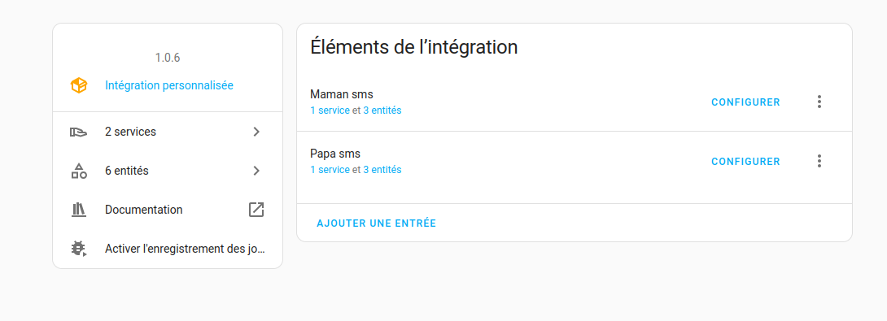
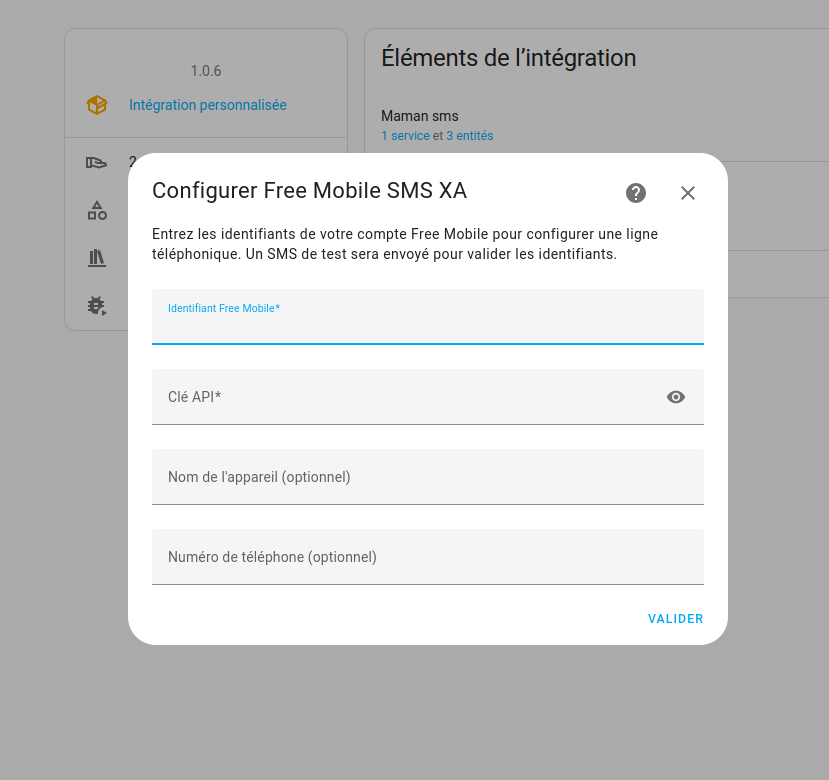
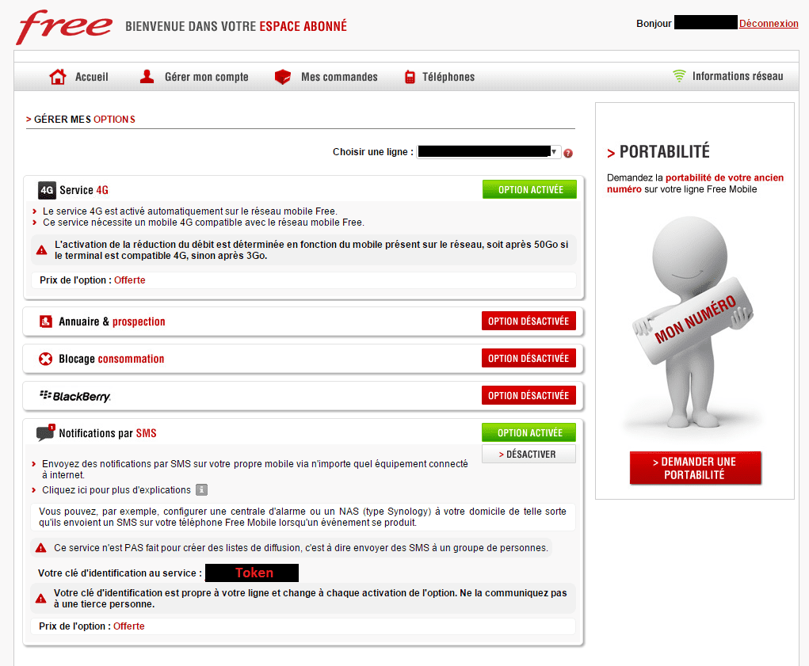

# 📨 Free Mobile SMS XA – Intégration Home Assistant


[](https://hacs.xyz) [](https://github.com/XAV59213/freesmsxa/releases/latest) [](https://github.com/XAV59213/freesmsxa/actions/workflows/hassfest.yaml) [](https://github.com/XAV59213/freesmsxa/actions/workflows/validate.yaml) [](LICENSE) [](https://github.com/XAV59213/freesmsxa/releases) [](https://github.com/XAV59213/freesmsxa/releases/latest) [](https://www.home-assistant.io)

[](https://www.buymeacoffee.com/xav59213)

## Via HACS (recommandé)

[](https://my.home-assistant.io/redirect/hacs_repository/?owner=XAV59213&repository=freesmsxa&category=integration)

[](https://my.home-assistant.io/redirect/config_flow_start/?domain=freesmsxa)


**Free Mobile SMS XA** est une intégration personnalisée pour [Home Assistant](https://www.home-assistant.io/) qui permet d’envoyer des notifications **par SMS** via l’API gratuite de Free Mobile. Elle prend en charge plusieurs lignes, crée des entités (capteurs, boutons, `notify`) et offre une carte Lovelace native.

---

## 🔧 Fonctionnalités

- 🔔 Envoi de SMS via `notify.<nom>` / `notify.send_message`
- 👥 Support **multi-utilisateurs** (ex : `Papa`, `Maman`)
- 📊 Capteur d’état : total, aujourd’hui, quota, dernière erreur
- 📜 Historique des **50** derniers SMS (succès et échecs), conservé après redémarrage
- 🚦 Gestion du quota Free Mobile (HTTP 402)
- 🔍 Diagnostics téléchargeables (clé API masquée) + option logs debug
- 🔘 Bouton test SMS personnalisable
- 📱 Carte Lovelace native **Envoyer un SMS** (`custom:freesmsxa-send-card`)
- 🔁 Reconfiguration de la clé API sans supprimer l’entrée

---

## 📸 Aperçu

### 🛠 Interface de configuration



### 🧩 Services configurés



### 🔑 Interface Free Mobile (Clé API)



---

## ⚙️ Setup

Shortcut:  

- Allez dans **Paramètres -> Intégrations -> Ajouter une intégration**
- Cherchez **Free Mobile SMS XA** et suivez les instructions.

---

## 🧰 Installation

1. Ouvre **HACS > Intégrations**
2. Clique sur **les trois points > Dépôts personnalisés**
3. Ajoute :
   ```
   https://github.com/XAV59213/freesmsxa
   ```
4. Sélectionne la catégorie `Intégration`
5. Installe **Free Mobile SMS XA**
6. Redémarre Home Assistant
7. Va dans **Paramètres > Appareils et services > Ajouter une intégration**
8. Cherche `Free Mobile SMS XA` et ajoute une ligne

---

## 🔐 Obtenir tes identifiants Free Mobile

1. Connecte-toi à ton [espace abonné Free Mobile](https://mobile.free.fr/moncompte)
2. Va dans **Gérer mes options**
3. Active **Notifications par SMS**
4. Copie ton **Identifiant utilisateur** et ta **Clé API**

---

## Paramètres de configuration

| Champ | Obligatoire / défaut | Usage |
|---|---|---|
| Identifiant Free Mobile (`username`) | Obligatoire | Identifiant de la ligne dont l’option Notifications par SMS est activée. Une entrée par identifiant. |
| Clé API (`access_token`) | Obligatoire | Clé des notifications SMS de cette ligne, pas le mot de passe du compte. |
| Nom (`name`) | Facultatif ; `Free Mobile SMS` si vide | Alias d’affichage. Le nouveau défaut ne reprend plus l’identifiant du compte. Les alias existants ne sont pas réécrits (compatibilité états/événements). Choisir un alias non sensible. |
| Téléphone (`phone_number`) | Facultatif ; vide | Numéro français, par exemple `0612345678`, `+33612345678` ou `0033612345678`. Conservé pour information ; il ne change pas le destinataire de l’API. |
| Envoyer un SMS de validation (`send_test_sms`) | Oui par défaut | Envoie un **vrai SMS** à la configuration. Désactiver permet de créer l’entrée sans vérifier réseau ni clé. Le démarrage/rechargement n’envoie pas de SMS de validation. |

### Options et reconfiguration

Dans **Paramètres > Appareils et services > Free Mobile SMS XA**, ouvre les options de la ligne :

- **Message du SMS de test** (`test_message`) : texte envoyé uniquement lorsque tu appuies sur le bouton Test SMS ; défaut `Test SMS envoyé depuis Home Assistant`. Texte non vide, maximum **1000 caractères** après suppression des espaces de début/fin. Ce texte est masqué dans les diagnostics de cette version corrigée.
- **Activer les logs de débogage** (`debug`) : désactivé par défaut. Active les traces techniques de l’intégration, sans y inclure texte SMS, identifiant de ligne ou exception HTTP brute. Le réglage de niveau du logger est global à l’intégration, pas isolé par ligne : le dernier chargement d’une entrée peut changer ce niveau.

Le menu **Reconfigurer** permet de modifier clé API, alias et téléphone sans supprimer l’entrée. L’identifiant de la ligne reste fixe. Une reconfiguration réussie envoie un vrai SMS de validation puis recharge l’entrée. Après un refus **HTTP 403** pendant un envoi, Home Assistant ouvre un parcours de **réauthentification** pour cette entrée. Il conserve la ligne, les entités et leurs identifiants. Ouvrir le formulaire n’envoie rien ; **valider la nouvelle clé envoie un vrai SMS de vérification**, puis met à jour la même entrée et la recharge. En cas de quota, panne réseau ou erreur serveur, aucun parcours de réauthentification n’est lancé ; tu peux réessayer l’action plus tard. Le menu Reconfigurer reste utilisable manuellement.

### Suppression

1. Dans **Paramètres > Appareils et services > Free Mobile SMS XA**, supprime l’entrée correspondant à la ligne. Ses entités et son appareil associé sont retirés par Home Assistant ; tes automatisations qui les ciblent devront être adaptées.
2. Répète pour les autres lignes si tu veux supprimer complètement l’intégration.
3. Supprime les cartes Free SMS de tes tableaux de bord. Si une ressource JavaScript `/freesmsxa/freesmsxa-send-card.js` a été ajoutée dans **Paramètres > Tableaux de bord > Ressources**, supprime aussi cette ressource quand aucune ligne/carte ne l’utilise plus.
4. Désinstalle Free Mobile SMS XA dans HACS, puis redémarre Home Assistant.

La suppression ne purge pas automatiquement les anciennes données du recorder ou les sauvegardes HA. Applique les outils de purge/rétention Home Assistant si nécessaire. L’option Notifications par SMS dans l’espace Free reste activée tant que tu ne la désactives pas toi-même.

---

## ⚙️ Exemple d’automatisation (recommandé)

Depuis Home Assistant 2024.6, le bon appel est `notify.send_message` sur l’entité créée par l’intégration :

```yaml
alias: Alarme activée
mode: single
triggers:
  - trigger: state
    entity_id: alarm_control_panel.maison
    to: armed_away
actions:
  - action: notify.send_message
    target:
      entity_id:
        - notify.maman
        - notify.papa
    data:
      message: Alarme activée
```

### Alternative : service de l’intégration

```yaml
action: freesmsxa.send_sms
data:
  target: notify.papa
  message: Alarme activée
```

`target` accepte `papa` ou `notify.papa`.

---

## 📱 Carte Lovelace native — Envoyer un SMS

Après mise à jour, **Modifier le tableau de bord → Ajouter une carte → Envoyer un SMS**.

```yaml
type: custom:freesmsxa-send-card
```

Si la carte n’apparaît pas : **Paramètres → Tableaux de bord → ⋮ → Ressources** et ajoute `/freesmsxa/freesmsxa-send-card.js` en module JavaScript, puis redémarre l’app.

Compteur 160 caractères intégré. Destinataires détectés automatiquement, option **TOUS LE MONDE !**.

---

## 📊 Historique, quota et debug

Le capteur **État SMS** expose :

- `sms_count` / `sms_today` / `quota_status` (`ok` ou `throttled`)
- `last_error` (`quota_exceeded`, `invalid_auth`, …)
- `sms_log` : 50 derniers envois (`time`, `status: sent|failed`, `length`, `error`) — le texte des SMS n’est plus stocké (vie privée) et l’attribut n’est pas enregistré dans l’historique

Deux capteurs numériques permettent de grapher **SMS envoyés** et **SMS aujourd’hui**.

Événements : `freesmsxa_sms_sent` et `freesmsxa_sms_failed`.

**Diagnostics** : appareil Free Mobile SMS → ⋮ → Télécharger les diagnostics (la clé API est masquée).

**Logs debug** : options de l’intégration → *Activer les logs de débogage*.

```yaml
type: markdown
title: Historique des SMS
content: >
  
  
  
  • **{{ item.time }}** [{{ item.status }}] {{ item.length }} caractères
  
  
  Aucun SMS.
  
```

Les IDs d’entités dépendent du nom de la ligne. Vérifie-les dans **Paramètres > Entités**.

---

## 🛡️ Sécurité

- L’intégration s’exécute dans Home Assistant, mais chaque envoi utilise **le service cloud Free Mobile** ; ce n’est pas un envoi hors ligne.
- Les diagnostics masquent la clé API, identifiant, nom/alias, téléphone et message de test personnalisé ; les champs de configuration inconnus ne sont pas exportés.
- Les logs propres à l’intégration ne contiennent pas le texte du SMS, l’identifiant ou l’exception HTTP brute. Cela ne garantit pas la confidentialité des logs d’autres bibliothèques ni des journaux déjà créés avant la mise à jour.
- Les événements `freesmsxa_sms_sent` et `freesmsxa_sms_failed` contiennent encore **le texte du message et l’alias**, pour préserver les automatisations existantes. Les abonnés au bus HA peuvent les lire ; ne partage pas leurs captures sans les nettoyer.
- L’alias reste visible dans les attributs et événements. Les nouvelles entrées sans alias utilisent `Free Mobile SMS` ; le nom d’appareil évite aussi l’ancien défaut égal à l’identifiant. Pour les entrées existantes, données/alias, titres de configuration et IDs ne sont pas réécrits : ils peuvent encore contenir l’identifiant. Nettoyer les captures avant partage. Les noms explicitement personnalisés par l’utilisateur ne sont pas censurés.

---

## Fonctionnement, limites et dépannage

### Mises à jour et limites connues

- L’API Free Mobile envoie uniquement à **la ligne du compte configuré** ; renseigner un autre téléphone n’en fait pas un service d’envoi arbitraire. Pour plusieurs destinataires, configure une entrée par ligne et ses propres identifiants.
- Aucun polling distant ni récupération de la boîte SMS : état et compteurs reflètent uniquement les tentatives faites par cette intégration. Les envois réalisés ailleurs ne sont pas comptés.
- Le compteur du jour est calculé avec la date locale HA au prochain accès/envoi ; aucun timer ne republie automatiquement l’état à minuit.
- La carte native et les helpers d’exemple limitent à **160 caractères**, tandis que les actions/backend acceptent jusqu’à **1000 caractères**. Le transport et les limites Free restent applicables.
- Le journal local garde au plus **50 tentatives**, sans texte SMS. Quota Free : le code HTTP 402 signifie une limitation ; aucun nombre d’envois garanti n’est présumé ici. Un HTTP 500 est réessayé une fois après deux secondes, contrairement aux erreurs d’identifiants.
- La carte cherche d’abord les entités Free SMS ; si aucune n’est trouvée, son fallback peut afficher **d’autres entités notify**. Vérifie la liste avant le mode « tous ». Ce comportement est conservé pour compatibilité, pas considéré comme filtrage de sécurité.
- Après une erreur de transport observée, **le capteur d’état devient `unavailable`**. Les compteurs locaux restent disponibles (leur historique reste valide) et les commandes notify et bouton activé restent utilisables pour un nouvel essai explicite. Ce nouvel envoi peut rétablir le capteur ; aucune sonde SMS ni tentative périodique n’est ajoutée. Une réponse HTTP rétablit la joignabilité même si le SMS est refusé pour clé/quota/message : le capteur montre alors `Error` ou `Quota`, pas un succès. Au démarrage, sans observation, il reste `Idle` avec `api_reachable: null` ; cela ne valide pas la connexion. Politique fondée sur la dernière action, pas une surveillance live.
- L’attribut `api_reachable` du capteur d’état indique la **dernière joignabilité de transport observée lors d’une action d’envoi (notify/action/bouton)** : `null` au démarrage, `false` après erreur réseau, `true` après réponse HTTP (même 400/402/403/500). Il ne garantit ni une clé valide, ni un quota disponible, ni la livraison du SMS. Il ne se restaure pas au redémarrage et n’expire pas avec le temps. Une première panne puis un retour observé sont journalisés une seule fois chacun au niveau INFO par entrée, sans identifiant/message ; les échecs répétés restent silencieux. Aucun essai réseau n’est ajouté en fond.
- Depuis HA2026.3, les images de `brand/` sont servies localement par HA. L’icône normale est carrée256×256 et la version haute définition512×512, fond transparent et proportions du logo conservées. Sur HA2025.12, le mécanisme local n’existe pas encore : affichage de la marque non garanti ; ce n’est pas une certification du critère brands de core.
- Le capteur d’état et le bouton de test sont classés **Diagnostic**, les compteurs et notify restent principaux. Les icônes par défaut passent par `icons.json` ; le bouton conserve une icône de message de test après usage au lieu du checkmark permanent. Les `entity_id`/`unique_id`, alias, icônes personnalisées et événements restent conservés ; cette catégorie peut modifier leur placement dans les dashboards générés automatiquement. Le nouveau naming notify et les exceptions de noms affichés sont décrits ci-dessous.
- Le statut utilise la classe HA `enum`, avec les valeurs historiques **Idle**, **Last sent**, **Quota**, **Error** inchangées (pas de changement de chaînes utilisées dans les automatisations). Un état de sauvegarde inconnu revient à Idle plutôt que de créer une valeur enum invalide ; les compteurs sont conservés.
- Le bouton **Test SMS** nouvellement créé est **désactivé par défaut**, car il sert au dépannage occasionnel. Pour l’utiliser : Paramètres > Appareils et services > Entités, afficher les entités désactivées puis activer Test SMS. Les boutons existants conservent exactement leur choix activé/désactivé et leur ID ; notify reste utilisable sans ce bouton. L’activer ou recharger l’entrée n’envoie jamais de SMS : seul l’appui explicite en envoie un.
- Chaque requête utilise des délais de connexion/lecture de **10/30 secondes**, transmis à requests via la bibliothèque. Ce n’est pas une borne totale de bout en bout (redirections/retry éventuels). L’executor reste utilisé : le transport n’a pas été remplacé par une bibliothèque asyncio.
- Les changements d’options rechargent l’entrée une seule fois via le mécanisme natif Home Assistant ; le listener générique a été retiré pour éviter les rechargements en double pendant la réauthentification/reconfiguration.
- La concurrence est explicitée par plateforme (capteurs sans limite, commandes bouton/notify une à la fois). Cela ne constitue pas un verrou global entre les plateformes ou entre les lignes.

### Résoudre les erreurs

| Symptôme | Vérifications / action |
|---|---|
| HTTP 400 / `invalid_message` | Message non vide, taille dans la limite backend ; vérifier le contenu et les paramètres. |
| HTTP 402 / `quota_exceeded` | Attendre avant de réessayer ; ne pas créer une boucle d’automatisation qui répète les envois. |
| HTTP 403 / `invalid_auth` | Vérifier identifiant, clé API et activation de Notifications par SMS dans l’espace Free. Suivre le parcours **Réauthentifier** proposé après le refus ; valider envoie un SMS de vérification. Le menu **Reconfigurer** reste disponible. |
| HTTP 500 / `server_error` | Incident serveur Free ; attendre puis retenter. Une seule relance automatique est prévue. |
| `connection_error` | Vérifier accès Internet de HA, résolution DNS, pare-feu et disponibilité Free. Les détails de requête ne sont volontairement pas affichés car ils peuvent contenir des secrets. |
| Carte absente | Ajouter le module JavaScript décrit plus haut et recharger le navigateur/l’application. Vérifier la ressource et vider le cache si nécessaire. |
| Cible inconnue / `invalid_target` | Vérifier l’entité dans Paramètres > Entités et utiliser `notify.send_message` ou le nom attendu par `freesmsxa.send_sms`. |

L’étude du transport async et les conditions non résolues de migration sont consignées dans [docs/TRANSPORT_DECISION.md](docs/TRANSPORT_DECISION.md). La dépendance reste `freesms>=0.2.0` : le pin0.3.0 essayé a été rejeté, car le core Free Mobile exige0.2.0. Les deux versions sont exercées en tests ; aucun pin incompatible n’est ajouté. La version de publication et le cache frontend sont alignés ; voir [CHANGELOG.md](CHANGELOG.md). Le transport de cette livraison reste synchrone en executor ; aucun timeout total ni session HA injectée n’est revendiqué.

Avant d’ouvrir une issue, fournir version HA/intégration et code d’erreur. Les diagnostics peuvent aider, mais vérifie toujours le fichier avant partage ; ne joins pas de clé API, texte SMS, captures d’événements ou logs anciens non nettoyés. Les modifications locales de qualité sont une autoévaluation, **pas un niveau Quality Scale officiel accordé à ce custom component HACS**.

---

## 🧰 Licence

Distribué sous **GNU LGPL v2.1** – [Voir la licence](https://github.com/XAV59213/freesmsxa/blob/main/LICENSE)

---

## 📚 Documentation

> Intégration créée avec ❤️ pour Home Assistant.  
> Pour toute question ou amélioration, [ouvre une issue](https://github.com/XAV59213/freesmsxa/issues).


### Noms d’entités et migration locale

Les cinq entités utilisent `has_entity_name=True` et une clé de traduction, notify compris (`sms` / « SMS » en français et anglais). Les noms configurés de ligne ne sont pas traduits. Une migration idempotente des métadonnées du registre est exécutée avant le chargement notify, sans changement de version du schéma de configuration, d’`entity_id`, de `unique_id`, de cible d’action, de nom/icône personnalisés ou d’événements. Les anciennes cibles continuent à fonctionner. Un alias notify historique choisi est retenu comme personnalisation de nom ; effacer cette personnalisation dans HA permet de suivre les nouveaux noms traduits.

Les anciens noms implicites égaux au compte ne sont pas retenus comme noms d’affichage. Les anciens IDs et alias d’attributs/événements restent néanmoins inchangés. Un nom explicitement personnalisé peut encore contenir l’identifiant, par choix utilisateur. Un champ de nom vide (`""`) est conservé tel quel ; HA2025.12 le traite comme absence de personnalisation et affiche le nouveau défaut. Si le nom d’appareil par défaut change pour supprimer l’identifiant, HA peut recomposer les préfixes des noms complets : contrôler les templates qui comparent `friendly_name`, plutôt que les IDs stables. Aucun engagement global sur toute automatisation fondée sur un texte d’affichage.

Détails, tests et limite du shim de compatibilité natif HA2026.11 : [docs/NAMING_MIGRATION.md](docs/NAMING_MIGRATION.md). Les deux versions HA testées ne prouvent pas toutes les versions intermédiaires/futures. Cette intégration HACS custom ne revendique aucun niveau Quality Scale officiel. Les documents d’audit conservent leur contexte historique antérieur à la publication.

Les décisions finales et les sept critères encore ouverts sont détaillés dans [docs/REMAINING_ACTIONS.md](docs/REMAINING_ACTIONS.md) ; il ne s’agit pas de sept bugs tous corrigeables localement.

### Sécurité de restauration du correctif local

Les métadonnées restaurées sont validées avant republication : compteurs non négatifs, horodatages valides, clés d’erreur connues et journal limité aux champs pris en charge. Les valeurs valides et les IDs sont conservés ; champs/chaînes non reconnus et entrées malformées peuvent être supprimés. Aucun SMS n’est envoyé lors de cette récupération. Cela **ne purge pas** les anciennes sauvegardes, historiques ou traces HTTP. Les alias/événements existants peuvent toujours contenir des données personnelles ; ne pas activer la trace HTTP globale sur des identifiants réels. Voir [docs/SECURITY_REVIEW.md](docs/SECURITY_REVIEW.md) avant diffusion.
